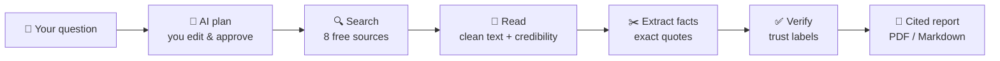

<div align="center">

# 🔎 Anveshan

### Ask a question. Get a research report you can actually trust.

**Every claim shows its source. Weak evidence is called weak. No AI key needed.**

[](#-tech-stack)
[](#-tech-stack)
[](#-tech-stack)
[](#-tech-stack)
[](#-tech-stack)
[](#-run-it-in-5-minutes)
[](#-why-its-free)

[Demo](#-demo) · [How it works](#%EF%B8%8F-how-it-works) · [Features](#-features) · [Run it](#-run-it-in-5-minutes) · [Roadmap](#-roadmap)

</div>

---

## 🎬 Demo

https://github.com/samarth-maheshwari-dev/Anveshan-Ai-research-and-skill-gap-analysis-platform-/raw/main/docs/assets/anveshan-demo.mp4

> Video not playing? [▶️ Watch / download the demo](docs/assets/anveshan-demo.mp4)

---

## 🤔 What is Anveshan?

*Anveshan* (अन्वेषण) means **"exploration / research"** in Hindi.

Most AI tools give you a confident answer and no way to check it. Anveshan works like a careful research assistant:

1. 🔍 It **searches** real sources — research papers, Wikipedia, GitHub, the web.
2. 📖 It **reads** them and pulls out short facts, each tied to the **exact sentence** it came from.
3. ✅ It **cross-checks** every fact against other sources and labels it honestly.
4. 📝 It **writes a report** where every sentence has a numbered citation you can click.

| Label | Meaning |
|---|---|
| ✅ **Supported** | A different, credible source agrees |
| ⚠️ **Weak evidence** | Only one source, or a low-credibility one |
| ⚔️ **Conflicting** | Sources disagree — shown in a Conflicts section |
| ❓ **No source** | Nothing could confirm it — listed as an open question |

These labels are decided by **fixed rules in code**, never by the AI.

**Who is it for?** Students writing papers, anyone researching a topic, and (coming soon) people who want to prove their skills with real evidence instead of a resume line.

---

## ⚙️ How it works



You stay in control: **nothing runs until you approve the plan**, and you can pause, skip a source or stop at any time.

---

## ✨ Features

<table>
<tr>
<td width="50%" valign="top">

### 🧭 Plan before you spend
The AI splits your question into 1–8 sub-questions. Edit, reorder, delete, add, or ask for a new plan ("focus on India"). A live estimate shows time and AI requests.

### 🔍 Search 8 sources at once
OpenAlex, Semantic Scholar, arXiv, Crossref, Wikipedia, GitHub, Tavily and a built-in SearXNG. Duplicates removed and ranked locally. **Retracted papers are dropped automatically.**

### 📺 Live Room
Watch the research happen — steps, sources found, conflicts, live log. Close the tab, come back later; it kept going.

</td>
<td width="50%" valign="top">

### ✅ Honest trust labels
Every fact quotes its source exactly (position found by code, not trusted from the AI) and is checked against *other* sources.

### 📝 Report Studio
Rich-text editing, citations that renumber themselves, click any citation to see the highlighted source passage. AI can simplify, expand or **translate to Hindi**. Every save is a version.

### 📊 Report at a glance
Key findings, evidence donut, top sources, source types & years, and a report map. Download as **PDF** (with Hindi font) or **Markdown**.

</td>
</tr>
</table>

---

## 💸 Why it's free

- **You don't bring an AI key.** One built-in gateway calls free AI endpoints (Gemini, Groq, freellmapi) with automatic fallback.
- **Embeddings run inside the backend** (multilingual-e5-small via ONNX) — no paid API.
- **Searching, ranking, labelling and scoring are done by code**, so the AI is called only where it's needed.
- Fair use: **5 researches per user per day**.

---

## 🛠 Tech stack

| Layer | Technology |
|---|---|
| **Backend** | Java 21 · Spring Boot 4.1 · Spring Modulith (modular monolith) |
| **AI** | Built-in LLM gateway with circuit breaker & fallback · JSON-schema validated output |
| **Embeddings** | multilingual-e5-small · ONNX Runtime (in-process, CPU) |
| **Database** | PostgreSQL 17 + pgvector · Flyway migrations |
| **Frontend** | Next.js 16 (App Router) · TypeScript strict · Tailwind v4 · shadcn/ui · TanStack Query |
| **Testing** | JUnit 5 · Testcontainers · WireMock · Vitest · Playwright |
| **DevOps** | Docker Compose · GitHub Actions |

<details>
<summary><b>📁 Project structure</b></summary>

```
apps/
├── api/    Spring Boot backend — one module per package under dev.anveshan
│           (identity, llm, research, sources, report, knowledge, skills,
│            team, notify, search, export, shared)
└── web/    Next.js frontend
infra/
├── compose.yml      Postgres (pgvector) + API + Web + SearXNG
├── smoke-test.sh    checks a running stack
└── backup/run.sh    pg_dump backup with verify + 14-day rotation
.github/workflows/   CI: api.yml, web.yml, stack.yml
```
</details>

---

## 🚀 Run it in 5 minutes

**You need:** [Docker Desktop](https://www.docker.com/products/docker-desktop/) (running) and Git Bash on Windows.

```bash
git clone https://github.com/samarth-maheshwari-dev/Anveshan-Ai-research-and-skill-gap-analysis-platform-.git
cd Anveshan-Ai-research-and-skill-gap-analysis-platform-/infra
cp .env.example .env          # set PG_PASSWORD and OAUTH_ENV_FILE
docker compose up -d --build --wait
bash smoke-test.sh            # expect: ALL SMOKE CHECKS PASSED
```

Open **http://localhost:3000** 🎉

<details>
<summary><b>🔑 API keys & sign-in setup</b></summary>

Keys live in a file **outside the repo** — set its path as `OAUTH_ENV_FILE` in `infra/.env`.

| Key | Needed for |
|---|---|
| `GEMINI_API_KEY` | Main AI model (free tier) |
| `TAVILY_API_KEY` | Web search (free tier) |
| `GROQ_API_KEY`, `FREELLMAPI_KEY` | Optional extra AI fallbacks |
| `SEMANTIC_SCHOLAR_API_KEY`, `OPENALEX_API_KEY` | Optional, higher search limits |
| `GOOGLE_CLIENT_ID/SECRET`, `GITHUB_CLIENT_ID/SECRET` | Sign in with Google / GitHub |

A blank key just means that service is skipped.
OAuth redirect URIs: `http://localhost:8080/login/oauth2/code/google` and `.../github`.

</details>

<details>
<summary><b>👩‍💻 Develop locally</b></summary>

**You need:** JDK 21, Node 24, pnpm 10, Docker Desktop.

```bash
bash apps/api/scripts/fetch-model.sh     # one-time, ~490 MB embedding model

cd apps/api && ./mvnw verify             # backend build + all tests
./mvnw spring-boot:test-run              # run backend

pnpm -C apps/web install
pnpm -C apps/web dev                     # http://localhost:3000
pnpm -C apps/web typecheck && pnpm -C apps/web lint && pnpm -C apps/web test
```

```bash
docker compose --profile backup run --rm backup   # backup
docker compose down                               # stop (add -v to delete data)
```
</details>

---

## 🗺 Roadmap

| Status | What |
|---|---|
| ✅ Done | Sign-in · AI planner · 8-source search · reading & credibility · fact extraction · trust labels · cited reports · Report Studio · Live Room · PDF/Markdown export · built-in free AI gateway · redesigned UI with charts |
| 🔨 Next | **Ask the Report** — questions answered only from the report's own sources |
| 📅 Planned | Sources Library · Knowledge Space (linked notes) · **Skill Proof Engine** · team workspace with faculty reviewer |

> **Skill Proof Engine (coming):** your skill level is calculated from real evidence — a viva on your own code, timed challenges, GitHub scans — not self-rating. Every level shows its evidence and a confidence score.

<details>
<summary><b>Detailed phase log (P00 – P17)</b></summary>

| Phase | What | Status |
|---|---|---|
| P00–P02 | Accounts, monorepo + CI, Docker stack, health, backups | ✅ |
| P03 | In-process embeddings (ONNX) | ✅ |
| P04–P06 | Schema + Flyway, Google/GitHub login, SSRF-safe HTTP, log masking | ✅ |
| P07–P08 | LLM gateway, frontend foundation | ✅ |
| P09 | Durable run engine: pause / resume / stop, live events, crash recovery | ✅ |
| P10 | Research form, AI planner, plan review | ✅ |
| P11–P12 | 8-source search, reading & credibility | ✅ |
| P13 | Claim extraction with exact quotes, verification, trust labels | ✅ |
| P14 | Cited report, Live Room, dashboard | ✅ |
| P15 | Report Studio: editing, versions, AI assist, find better sources | ✅ |
| P16 | Built-in AI gateway — no user keys, daily limit | ✅ |
| P16b | PDF + Markdown export ✅ · background export jobs | 🔨 |
| P16c | Redesigned UI, charts, report map, faster & richer reports | ✅ |
| P17 | Delete research ✅ · Ask the Report | 🔨 |

</details>

---

## 🔐 Security

- 🔑 Sign in only via Google / GitHub; server-side sessions, CSRF and strict CORS.
- 🙈 AI keys never leave the server — never logged, never returned, masked as `****`.
- 🛡 Every user-supplied URL goes through an **SSRF guard** (private IPs blocked, DNS rebinding checked, redirects re-checked).
- 🧪 Web page text is treated as **untrusted data** — a hidden "ignore previous instructions" can't add a claim, because every claim must quote the page exactly.
- 🔒 All data is scoped to its owner in SQL; someone else's research returns 404.

Found a security issue? Please open a **private security advisory** instead of a public issue.

---

<div align="center">

**Built solo by [Samarth Maheshwari](https://github.com/samarth-maheshwari-dev)** · student project

⭐ Star the repo if you find it useful!

<sub>Reports are AI-assisted research drafts — verify before submitting them anywhere.</sub>

</div>
